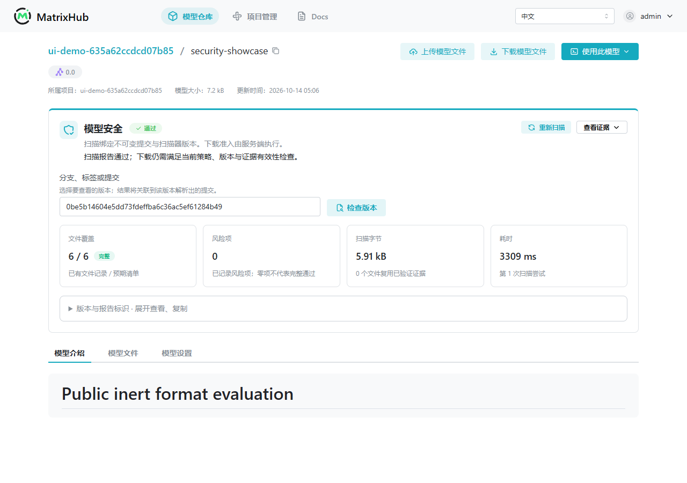

# MatrixHub Model Artifact Security

**Static inspection, revision-bound evidence, and server-side download admission for model repositories.**

English · [简体中文](README.zh-CN.md) · [Test report](TEST_REPORT.md) · [Limitations](LIMITATIONS.md) · [Release notes](RELEASE_NOTES.md) · [Code map](CODE_MAP.md)

A **v12.1 contribution snapshot derived from [matrixhub-ai/matrixhub](https://github.com/matrixhub-ai/matrixhub)**. It adds isolated model-artifact inspection, immutable revision evidence, server-side download admission, and an append-only review UI. This is not an official MatrixHub release or a claim of upstream acceptance.

Model files may contain executable deserialization references, unsupported serialization, or truncated storage. The integration separates *a finding* from *complete inspection*: inconclusive analysis never becomes download approval.



*The recorded interface is in Chinese and uses small controlled fixtures. Separate API evidence covers the trained BERT artifact and synthetic GiB capacity fixture.*

## Three practical scenarios

| Scenario | Implementation | Verified scope |
| --- | --- | --- |
| Publish a model and update its versions | Inspect supported formats, reuse complete analysis for matching content and scanner generation, and create a report for every immutable revision | Public BERT-Tiny weights, shards derived from the same weights, README-only changes, and a separate synthetic 1 GiB capacity fixture |
| A model file contains executable deserialization references | Combine antivirus and static inspection, record risky references, and deny protected downloads on the server; reviewer opinions do not override admission | Inert risk fixtures, actual API denials, and continued access to a previously accepted revision |
| An artifact is incomplete or its evidence becomes stale | Keep truncated files and unsupported semantics inconclusive; require evidence from the current scanner generation | Incomplete revisions, generation changes on the same commit, and a separate large-file prefix diagnostic |

```text
HF/API upload → immutable revision and file inventory → bounded staging / prefix probe
                                                               ↓
                                                isolated ClamAV + static inspection
                                                               ↓
                                             complete evidence + generation + policy
                                                               ↓
                                              server-side admission → UI / audit / review
```

## What this contribution adds

- Isolated ClamAV and static model-format inspection without loading an untrusted model.
- Restricted semantic checks for supported CPU legacy tensor construction and storage bounds.
- A bounded legacy-prefix probe that can reject invalid metadata during server-side staging. It only returns reject/pending, never approval.
- Bounded cross-file pipelining: stage a next batch while scanning a completed prior snapshot.
- Complete-file evidence reuse scoped to content and scanner generation, with a new immutable report for each revision. Files are still fully staged and hashed; reuse skips repeated analysis.
- Permission-aware admission and audit records; reviewer opinions do not change machine findings or unblock a download.

**ClamAV 1.4.6 and Picklescan 1.0.5 are third-party engines.** We contribute the integration, additional restricted format checks, scheduling, evidence contract and admission flow; we do not claim to have created or optimized their engines.

## Verified local results

Evidence cut: **2026-10-14, Asia/Shanghai**.

| Validation | Observed result |
| --- | --- |
| Current complete application | 794/794 business assertions; 11 revisions, 12 reports |
| Separate scanner-generation transition | 17 + 23 assertions passed |
| Human-review API | 55/55 checks passed |
| Desktop browser | 8/8 checks passed at 1280×900 |
| Full downloads | 27, totaling 1,180,190,711 bytes, with returned SHA256 checks |
| Real UI recording | 224.92 seconds, using small controlled fixtures |

The trained artifact is one public BERT-Tiny family; derived shards are not independent model families. The GiB artifact is a **synthetic capacity fixture**, not a GiB trained model. The 794 checks are assertions, not attack samples or an accuracy denominator.

One local V7 repository report took **114.534 s with 8 cached files**; a subsequent README-only V8 took **3.386 s with 12 cached files**. These are different workloads, not a controlled speedup or latency percentile. A separate production-component diagnostic rejected an invalid ~1 GiB legacy artifact after reading **64 KiB in 2.281 s**. That is repository/LFS-to-snapshot staging after upload, not inline inspection of the initial upload.

See the [English test report](TEST_REPORT.md), [original Chinese HTML report](reports/MatrixHub-v12.1-测试与设计报告.html), [original Chinese PDF report](reports/MatrixHub-v12.1-测试与设计报告.pdf), and [recorded UI demo](media/matrixhub-security-demo.webm). GitHub file previews do not start the application; download the HTML report to view it locally.

## Source and reproduction

`source/` contains the full application snapshot; `reproduce/` provides verification/build/smoke entrypoints; `evidence/` holds hashed receipts. Exact identities and dependencies are in [VERSION_LOCK.json](VERSION_LOCK.json).

```bash
python3 scripts/verify_publication.py
python3 reproduce/verify_source.py
```

The first command checks the clean checkout's complete publication inventory and original-delivery mapping. The second checks all **1,527 source files**. Neither starts the application or loads a model. The source-verification entrypoint was tested in an independently extracted directory; that does not establish successful deployment on a new machine.

Consult the [reproduction script](reproduce/reproduce-linux.sh), [security deployment guide](source/deploy/security/README.md), [scanner guide](source/deploy/security-scanner/README.md), and [original reproduction notes (Chinese)](README.zh.txt) before building. Building requires Linux/amd64, CGO/Go, Node/pnpm, Python, Docker Compose, complete ClamAV rules, and external dependencies. Exact versions are recorded in the version lock.

```bash
bash reproduce/reproduce-linux.sh build
# Prepare rules and a fresh dedicated environment before using up/test-* commands.
```

A full cold-cache, new-machine replay has **not** been completed. The default **64 MiB** file limit is not the GB test configuration; the latter needs its own profile, clamd limits, resource budgets, and timeouts. Use a new dedicated instance and fresh test credentials.

Current official `make test.e2e` / `make test.e2e.kind` suites were **not rerun for this candidate**. Three official E2E binaries were compiled. Historical KIND executions are reported separately and had security disabled. Prior intermittent browser timeouts remain unresolved; mobile acceptance and the planned 16-hour soak are incomplete. Full antivirus inspection still requires the complete artifact. See [LIMITATIONS.md](LIMITATIONS.md).

## Attribution

Upstream base: `84bb83043dc17b6cb3d1858620ac40c171bd8eff`. The export contains 44 explicit overlays and five sanitized upstream test helpers; `VERSION_LOCK.json` identifies the exact tested source. Original MatrixHub work remains attributed to its contributors under [Apache-2.0](source/LICENSE). Third-party engines retain their own licenses. A local DCO sign-off does not establish an upstream merge or maintainer endorsement.

## Publication integrity and provenance

The English documentation update changes the repository presentation, not the frozen tested source or original evidence. **The `v12.1` tag and its downloadable assets retain the initial publication snapshot.** Use the manifest from the same checkout you are verifying, rather than mixing the release asset manifest with a newer `main` checkout. The original Chinese reports and UI recording remain available alongside the English documentation.

Read [PUBLICATION_NOTES.md](PUBLICATION_NOTES.md) and [CODE_MAP.md](CODE_MAP.md). Frozen source documentation may describe historical versions; the current identity is in VERSION_LOCK.json and the current results are in TEST_REPORT.md. Some original evidence retains non-secret Windows workstation paths. In a clean checkout, run `python3 scripts/verify_publication.py` for the complete publication inventory, then `python3 reproduce/verify_source.py` for the listed source. The optional CI template remains under docs/ci-templates and is not enabled. No GitHub workflow permission or cloud run is claimed.

Reproducible reports about format compatibility, false rejections, evidence contracts, deployment, and upgrades are welcome. Follow [SECURITY.md](SECURITY.md) when reporting security issues.
