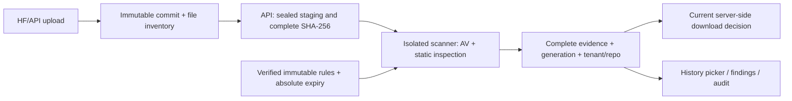

# MatrixHub Model Artifact Security — v15 candidate

**Revision-bound model inspection and server-enforced download admission, integrated into MatrixHub.**

This development contribution is derived from [matrixhub-ai/matrixhub](https://github.com/matrixhub-ai/matrixhub), under [Apache-2.0](source/LICENSE). It is not an official MatrixHub release or a claim of upstream acceptance. Authors: **Tianyi Lin and Jiaying Zou, Fudan University**. Current results below concern the v15 candidate; older publication files describe their original historical versions.

Read the [nine user goals and rubric evidence](source/docs/model-security-v15-goals.md), [v15 developer notes](source/docs/model-security-v15.md), [Linux build and deployment guide](source/deploy/security/README.md), [Chinese deployment quickstart](source/deploy/security/QUICKSTART.zh-CN.md), and [threat model](source/docs/security/threat-model.md).



## What changed

- **History without copying a SHA.** Choose branches, tags and paginated commits by title, date and short SHA. Requests use the complete immutable commit. Loading or mismatched revisions hide old evidence. English and Chinese locale entries are included.
- **Bounded native parallelism.** One active request can use 1, 2 or 4 native workers. Ordered whole-file waves contain at most 2 GiB and the configured worker count. Every wave joins before the next; the whole request shares CPU/wall budgets. This is internal parallelism, not horizontal replicas sharing staging.
- **Rule preparation and deployment preflight.** Official complete CVD signatures, engine load, byte hashes, daily-derived freshness, anti-rollback and expiry are checked before atomic snapshot activation. Compose uses UID/GID 65532, read-only rules, API-RW/scanner-RO staging and a mode-0660 Unix socket.
- **Typed container writes.** A bounded static proof rejects SETITEM/S writes to unproven map targets, including memo aliases and unknown reducer results. It does not execute reducers or prove arbitrary model-loader semantics. This new37d identity is kept separate from earlier16a measurements.
- **Evidence remains the admission contract.** Full-file identity, coverage, generation, current permissions and policy must agree. Cancellation, lease ownership and compare-and-swap prevent stale work from approving content. Forced rescans bypass analysis reuse.
- **A small security Helm chart.** One API and scanner share one Pod, a single staging writer and existing Secret references. Its network boundary differs from Compose's networkless scanner and needs actual allow/deny checks.

ClamAV 1.4.6 and Picklescan 1.0.5 remain third-party engines. Our work covers their integration, restricted format defenses, scheduling, evidence, admission, UI and deployment tooling. Static scanning does not prove a model safe against every threat and does not evaluate generated output or training backdoors. Inert Pickle references and harmless EICAR controls are identified as such.

## Current measured evidence

Evidence cut: **2026-10-23 07:51 +08:00**, still a candidate. Later execution outcomes are recorded in the [public evidence index](evidence/v15/INDEX.md) and the accompanying final technical report; pending describes this checkpoint. Each row has its own binary, scanner and workload identity; these scopes must not be merged into a larger claim.

| Scope | Actual result and limit |
| --- | --- |
| Source16a + real small application | `small-app-v2-prep`, run `780a61768189559f`: **8 API scenarios + 10 SDK checks passed**, plus anonymous 403; whole run 83.2625 s, worker 39.277947 s. Full GET, reuse, new risky revision/old safe revision, incomplete files, repair, rescan and quota denial. SDK identity, logout and cleanup passed. No GB transfer, browser or cross-generation restart in this run. |
| Source16a exact1GiB application canary | `6fb11bbc54394f32b3460c85b3692efe`: four256MiB files, batch4; complete zero-cache report and full GET hashes passed. WholeVM372.2542s, upload/scan/download48.8784s, SDKwhole47.7751s, report40.208s. No native sweep rerun or100GB claim; these times are not the native-only19.032s pilot. |
| Actual product UI and persistence | Personal run `8d21241da7e40ec5`: browser `80ecf413` passed normal login/logout, three scenarios/six versions, history switching, pending-evidence hiding and pagination; persistence `b223924d` passed owned-container restart and same-password fresh login. Those browser and restart proofs retain their separately recorded e195 compatibility identity; the new typed upgrade is listed separately below. No Docker Desktop engine-restart experiment is claimed. |
| Native controls and recovery | Source16a run `d95b363dde3085a0`: **14/14 control assertions passed**, including EICAR signature matches. Four bounded archive rejections each restarted owned clamd and recovered through a full benign scan in **15.65–15.79 s**. An expected incomplete OBJ-prefixed case is not a clean verdict. |
| Equal-work synthetic pilot | 9 configurations / 21 requests, four 256 MiB files (1 GiB). 1-thread/batch4: 67.591107 s; 4-thread/batch4: 19.032060 s; observed **3.55143×**, 53.80395 MiB/s. Warm OS cache, one ordered sweep, no repetitions/confidence interval; no extrapolation to 900 MB shards or 100 GB application throughput. |
| Native cancellation/crash recovery | Run `a0066d0aec846449` passed the clean/cancel-four-live/crash/recover/cleanup sequence. **76.2127425 s is the entire sequence**, not cancellation latency. Independent small1/2/4 and real1/2 scanner runs have separate receipts. |
| Trusted rules preparation | Snapshot `4d907501…52b40`, manifest SHA-256 `2d276de314cda5b1e4f5a3a25331cbf66f907b441b471241986edc7cfd597a63`: official three-CVD signature and full engine-load checks passed. Daily v28160; expiry `1793168749` (2026-10-28 06:25:49 UTC). Expiry0 compatibility runs do not inherit this freshness result. |
| Source/build checks | Go Linux ELF `c2b1cd83…47fb`; 421 passing test events include subtests. An earlier280/280 complete-SHA checkpoint matched the compilation manifest; the later SQLite test-only correction is tracked separately and final full-source freeze remains separate. UI candidate v2 passed lint, TypeScript and asset build; its frozen manifest records five feature test files /19 tests, with skipped count not separately preserved. |
| Corrected original make test.unit | Test-only SQLite schema-version expectations were corrected. Run `e946a32d5922f8b6d6d734bccd46a4d4`: **PASS**, whole155.1657s/target94s, Go1.26.8 CGO1/default flags,49 selected packages all ok or no-test marker, noOOM/full source+SDK+module integrity/cleanup. Case and skipped counts are unknown; no race claim. ProductionGo C2b is unchanged and the previous failure remains. |
| First 100 GB application attempt | Run `78dc298c…`: **FAIL**. Input generation produced 373 files / 100,000,000,000 B in 811.0745 s; bootstrap passed, then the wrong SDK client image lacked `huggingface_hub` and failed before upload. Whole run 1131.8136 s. Generation is not an upload/scan/download capacity pass. |
| Source16a complete100GB application | Run `9f604b528c0844aea34be049eb80cd5c`: **PASS**, 373 source files / decimal100,000,000,000B, zero-cache full repository scan and every GET hash, logout and cleanup. Whole6656.2572s, upload/scan/download5524.6979s; generation8df3. Report374files includes attributes. This measured source16a result is not a source37d typed APP claim. |
| Typed source37d static/native checks | Static160 tests and41 inert advisory controls passed;21 full-AV controls (5 valid/16 expected incomplete) and three real BERT/GPT2 artifacts totaling1,507,777,036B passed (whole134.8065s/native129.7743s, noOOM/cleanup). Default bundle GET6b355 passed with fresh rules; no model deserialization or CVE exploitation. Typed Chart and41GB APP require their own acceptance; the personal typed upgrade and browser outcomes are listed separately below. |
| Original make test.unit | New run `67c511ec6c29bb9f44a3a419435c2407`: **FAIL**, actual CGO1/default flags; target92s exit2, whole153.2537s. Only internal/infra/db failed. Source inspection found two SQLite version2 expectations conflicting with schema3, an inferred cause; actual failed testcase IDs were not retained. The separate test-only correction and rerune946a32d passed; the initial failure and earlier421 passing events retain their own scope. |
| New security Helm / KIND | First run `32be9…`: deployment (73.004666 s), current rules identity and actual NetworkPolicy allow/deny probes passed; overall **FAIL** after an auxiliary-Pod deletion timeout, before application acceptance. At that historical attempt a correction was pending; the later independent strict v4 PASS is recorded below. Shared-Pod networking is explicit. |
| Typed37d Chart v2 component results | Run `3a4b9e4d05ef965bbda682461c332cb5`: overall **FAIL481.25s**, cleanup passed. Original8 API+10 SDK passed (application27.805456s), actual DNS/DB allow and unselectedTCP deny passed, same Pod before/after ready with both restart counts0. NodePortSSH TCP/banner/tool passed but RSA0/exit1; loopbackRSA passed. This is not a complete Chart PASS. |
| Typed real41GB first boot attempt | Run `17f439eca9d843679e8098b501ecfa2b`: **FAIL boot-deadline241.443s**, no observedGuestReady/retainedAPP result, cleanup passed. This is a host boot failure, not a model scan outcome. A separate host-only boot-window derivative retains the same immutable41GB ISO and application assertions. |
| Original official187 target v2 | Run `9c5b64d8146c5b22d2fb650efb2e3a43`: **FAIL607.9364s**, target phase289.501163s, cleanup passed. Runnerexit1/noOOM/stdout0B/stderr974B, invalid resultJSON and fixedValueError/traceback classification. Case pass/fail/skip counts are unavailable; Chart APP18 does not substitute for this complete target. |
| Typed real41GB second application attempt | Run `192a8e1b99ee4677ae196eef6ef17ecb`: **FAIL1230.9282s**. READY/storage/preflight/engine/input preparation/bootstrap passed; the317.88056s upload-scan-download stage failed at SDKcommit. Workerexit2/noOOM, PATrevocation/logout/cleanup passed. No application/cleanGate/negative result or full coverage/download evidence was retained; this does not establish a scanner verdict or a confirmed product defect. |
| Original official187 target v3 | **Strict overall FAIL597.297s**; original target exit0, actual184PASS/3SKIP/0FAIL. SkippedM00036/SP0020/SP0030, Git0/delay0/disconnect0; runnerexit2, valid JSON, no stderr/OOM, source integrity and cleanup passed. This is not complete187 acceptance. |
| Typed personal-instance upgrade | Run `bffcee515b254a29`: **PASS55.1786394s**, scanner37d/GEN2d7f. Same account, volumes, APIC2/UIv2 and31227 retained; six immutable versions force-rescanned uncached, four fullGET and two denials verified. This is separate from browser acceptance. |
| Typed personal browser first attempt | Check `8264903c11b4426d`: **FAIL4.75s** at browser-launch/target-closed, zero screenshots; exactowned Job and temporary profile cleanup passed. At that historical Edge attempt no newtyped UI PASS existed; the later independent matching-Chromium PASS is recorded below. Olde195 UI PASS retains its own identity. |
| Typed37d Chart v3 | **Strict overall FAIL435.704s**; original APP8+SDK10 PASS23.641548s, CNI controls and same-Pod two ready/zero-restart checks passed. NodePort six bounded hostname attempts hadRSA0/exit1 while Pod loopbackRSA1; complete component facts and cleanup retained. Newv4 remains an independent attempt. |
| Generic typed fresh initialization | Two new-empty-fixture runs **FAIL25.907s /25.547s before initialization**. POSIX/image proofs and cleanup passed; no normal-login/restart proof. The resource-unit parser correction has33 pure setup tests, not a replacement for a new real smoke. |
| Edge preauth diagnostics | Two credential-free attempts **FAIL80.422s /79.812s**; original launch target-closed and parentRefused. Profiles removed. A missing second result does not prove that mode never started. Matching Chromium preparation retains all UI oracles and requires a new actual result. |
| Typed37d strict Chart v4 | **PASS461.484s**, source37d/freshGEN6b355: original8API+10SDK, actual CNI allow/deny, samePod before/after ready with zero restarts, bothSSH roles with matching canonicalRSA and cleanup. Hostname failure followed by exactowned IPv4 success is observed, not a unique NSS cause. This proves Pod-level policy and SSH readiness, not per-container isolation/SSH authentication/official187/41GB. |
| Typed same-account Chromium UI | Check `25c0104ccd1a4946`: **PASS24.484s**, source37d/GEN2d7f, fresh incognito normal login/logout,3models6fullSHA/currentGEN, pending stale-evidence hiding,20+page2 and ownedJob/profile cleanup. Chromium ready was proven before DPAPI use. ROOT viewed all10 public screenshots; no detection-accuracy claim. OldEdge failures remain. |
| Generic fresh v2 partial progress | **FAIL56.906s**: firstInitialize/new72UTF8B Unicode/rulesSnapshotVerified true, POSIX/image proofs and cleanup true, but subsequentstart failed and normalLoginfalse. This is not full one-command deployment or Go login/restart acceptance. Newv3 is diagnostic-only until a separate actual receipt. |
| Original official187 v4 checkpoint | Actual v4 terminal **FAIL614.75s**, target292.528911s, allcleanup true. Case/STOP counts were still being extracted at this checkpoint and are not guessed; see the public index/final report. The older v3 strictFAIL184PASS/3SKIP is retained separately. |
| Historical upstream integration | An earlier complete official target did not pass. Its local historical records are not included in this candidate's verifiable result counts; they do not validate the new chart. |

See the [included public evidence index](evidence/v15/INDEX.md) and exact [copy hashes](evidence/v15/public-receipts-manifest.json).

At this source checkpoint the technical report is a **preview**, with exact receipt paths/hashes and pending items in its data file. The independently frozen final report is delivered separately; later actual outcomes appear in the public evidence index. The source16a 100GB PASS is a complete workload-specific application result. No overall detection accuracy, universally optimal concurrency, source37d typed capacity claim or community endorsement is inferred from assertion counts.

## Shortest Linux deployment path

Use a dedicated Linux POSIX filesystem and a fresh Compose project. Prerequisites: Go 1.26.8 with a C compiler, Node/pnpm 10.x, Python 3.11+, and Docker Compose v2. See the [complete guide](source/deploy/security/README.md) for resources and troubleshooting. From this checkout:

```sh
cd source
(cd ui && pnpm install --frozen-lockfile && pnpm build)
mkdir -p bin
CGO_ENABLED=1 go build -trimpath -buildvcs=false -o bin/matrixhub-security ./cmd/matrixhub
docker build -f deploy/security/Dockerfile.runtime -t matrixhub-security:local .
docker build -t matrixhub-security-scanner:1.4.6 deploy/security-scanner
```

These Dockerfiles may obtain their pinned public bases and packages during the explicit build. A locally inspected `sha256:` image ID is daemon-local evidence, not a registry-pullable image reference. `setup.py` never pulls missing images; build or explicitly pull/provision the exact images first. Images and rule databases are not included in a source-only submission.

Obtain complete `main.cvd`, `daily.cvd` and `bytecode.cvd` through official ClamAV FreshClam or a verified official offline transfer. Do not substitute an empty or test rules directory. For an offline import:

```sh
python3 scripts/newsetup/rules_snapshot.py prepare   --source /srv/official-cvd --store /srv/matrixhub/rules
python3 scripts/newsetup/setup.py check   --rules-store /srv/matrixhub/rules --state /srv/matrixhub/demo   --project mh-sec-demo
```

Initialize and start this new owned SQLite deployment, with a password prompt before any API port is published:

```sh
python3 scripts/newsetup/setup.py start --initialize-admin \
  --rules-store /srv/matrixhub/rules --state /srv/matrixhub/demo \
  --project mh-sec-demo
```

Use `initialize` to leave services stopped; later `start` commands omit `--initialize-admin`. Second initialization or a nonempty/existing account is refused. Passwords use getpass or explicit anonymous `--password-stdin`, never arguments/environment/logs. An earlier source checkpoint passed45 offline setup contracts. Two subsequent typed fresh smokes failed before initialization despite POSIX/image proofs and cleanup; a resource-unit parser fix passed33 setup unit tests. Later v2 actually initialized a new72UTF8B Unicode password and reverified rules, then failed at start (whole56.906s); normal login/restart remain unproven. These commands are the implemented candidate path, not a fresh-machine deployment PASS. The Windows DPAPI personal-demo helper is a different owned fixture.
For a trusted network refresh, preserve every existing FreshClam/CDN cooldown, then make one explicit `rules_snapshot.py update --store ... --network-not-before <known-gate-epoch>` attempt. Use zero only when no earlier cooldown exists. The seven-day maximum age is derived from verified daily database time; trusted host time is required. At expiry or rules change, admission fails closed. Activate a new immutable rules directory and recreate the scanner; never mutate mounted rules in place.

The measured snapshot expires at `1793168749` (2026-10-28 06:25:49 UTC). An
October 29 demonstration requires a normal rules update/prepare, actual
signature/freshness verification and validation of the resulting new generation.
Do not turn freshness off, reset a previous FreshClam gate or reuse an expired
green report. Deployment simplification currently covers fresh SQLite Compose;
Helm/MySQL still requires its documented Secret and administrator bootstrap.

Docker named volumes must supply real POSIX metadata. A Windows G:/exFAT bind was actually rejected after `fchmod(0440)` returned EPERM. Use Linux/ext4 storage, including an explicitly provisioned VM on the capacity disk; do not weaken permissions or move unrelated Docker data. The default profile is small. The separate [large-repository profile](source/deploy/security/profiles/README.md) retains snapshots and needs full physical copy/retention budgets. Current GB single-file cap is **1280 MiB**: neither a 100 GB single file nor a 1,503,300,328-byte Qwen file fits it.

The large synthetic workload is decimal **100,000,000,000 B in 373 files**,
not 100 GiB. The scanner's 1280 MiB policy differs from ClamAV's technical
2,147,483,645-byte ceiling. `report.scannedBytes` also includes reused cached
files; native scanned bytes require a zero-cache report or separate native
request evidence.

For Kubernetes, follow the [independent chart guide](source/deploy/security/helm/README.md). It needs verified immutable rules, pre-provisioned images/PVCs, an existing MySQL Secret and an actual CNI allow/deny test. It does not initialize or reset an administrator. A successful local render does not prove deployment on a fresh machine.

## Source checks and reproducibility

The publicly fetchable delta base is the public wrapper/fork commit
`3dab67d48e9deba5bd83b8428afcc6c1e45ad816` (public wrapper/fork `main`, checked without
credentials). This is not a commit in the `matrixhub-ai/matrixhub` upstream repository. The local v15 iteration began at
`35caf52d13bb1feaca89b11cefd4baca8f59f47a`; that is a local parent, not a
publicly published prerequisite. A submission delta must include all relevant
source changes since the public base, including the intermediate v13/v14 work
and new untracked files. The final explicit source/evidence inventory is
separate from these historical commit identities.

```sh
cd source
python3 -m unittest discover -s scripts/newsetup -p 'test_*.py'
# UI checks use the locked dependencies in source/ui; see its package scripts.
# Real scanner validation and workload boundaries:
# deploy/security-scanner/README.md and docs/security/scanner-validation.md
```

See [code architecture](source/docs/code-architecture.md), [development](source/docs/development.md), [security design](source/docs/security/design.md), [scanner validation](source/docs/security/scanner-validation.md), [history UI acceptance](source/scripts/newsetup/UI_ACCEPTANCE.md) and [v15 contribution notes](source/docs/model-security-v15.md). A new local source build is reproducible input preparation; no fresh-machine full reproduction pass is claimed yet. Competition rubric evidence and community recognition are separate; no external publication is performed automatically.

## What the public source package can reproduce

The public delta contains this README, `source/` and explicit small public `evidence/v15/` copies. Consumers apply it to the public3dab67d base and use their own Linux/POSIX storage, engine/image prerequisites and newly initialized deployment. Rules, model weights, live account data, DPAPI blobs, caches and this workstation's runtime VM orchestration are outside the source delta.

| Delivered source entry | Reproduction scope |
| --- | --- |
| [Deployment guide](source/deploy/security/README.md), [Chinese quickstart](source/deploy/security/QUICKSTART.zh-CN.md), `scripts/newsetup/setup.py` / `rules_snapshot.py` | Build/prepare images and verified rules, preflight, then guarded fresh SQLite Compose initialization. Use a new owned project and the documented interactive/stdin password entry. Helm/MySQL has its own Secret/bootstrap prerequisites. |
| `make test.unit`, `make test.sqlite`; upstream `make test.e2e.kind` | Original source test targets with their documented Go/CGO, database, Docker/KIND, image/tool and new-test-instance prerequisites. Official187 has an actual failed attempt; the source target's existence does not grant an acceptance result. |
| [Scanner validation guide](source/deploy/security-scanner/README.md), `tests.py`, `typed_write_tests.py`, `parallel_tests.py` and `native_driver.py` | Static and real native-engine validation in a newly isolated Linux scanner environment with explicit read-only rules/inputs. The current canonical source37d creates its own generation and results. |
| `scale_fixtures.py`, `scale_benchmark.py`, `scale_curves.py` | Prepare bounded synthetic fixtures; run whole-file native protocol/phase measurements; render new public JSONL points. Each new source/rules/profile/cache state is recorded. Existing source16a pilot and100GB receipts remain historical measured identities. |
| UI package scripts and [manual UI acceptance](source/scripts/newsetup/UI_ACCEPTANCE.md) | Rebuild/check current assets and inspect history/report behavior against one's own fresh instance. The saved browser receipts retain their original source/profile. |

The retained `source/scripts/security/e2e.py`, `workload.py` and `faults.py` are earlier API/HF-client test utilities. They have their own credential-environment, optional historical client-lock and fixed deployment/project assumptions; they are not the current isolated8+10 or100GB VM controller. Their presence does not reproduce the exact current SDK image pins, disposable VM lifecycle, POSIX guards and evidence protocol.

The complete source16a100GB upload/scan/full-GET result, typed41GB attempts and personal DPAPI/browser runs were produced by separately reviewed local isolation harnesses. The public package supplies their allowlisted receipts and exact identities, **not the same offline VM orchestrator**. No single command in this package exactly replays every nine-hour experiment. Re-running the delivered feature checks or benchmarking the current37d source produces a new receipt; it must retain its own source/generation rather than inherit an old PASS. The nine-goal coverage document records these remaining reproduction boundaries.

## Historical publications

Historical `TEST_REPORT.md`, `README.zh-CN.md`, `RELEASE_NOTES.md`, `LIMITATIONS.md` and `CODE_MAP.md` are available in the public3dab67d base and are not duplicated in this increment. The two earlier v13 `docs/improvements/` notes are local historical references outside this package. All preserve their original scope. Current included documentation is the [v15 developer note](source/docs/model-security-v15.md), [nine-goal coverage](source/docs/model-security-v15-goals.md) and [public evidence index](evidence/v15/INDEX.md).

`VERSION_LOCK.json`, `PUBLICATION_MANIFEST.json`, old screenshots/video and historical `reproduce/` publication checks describe their original snapshots. They are not the v15 source or acceptance lock.
