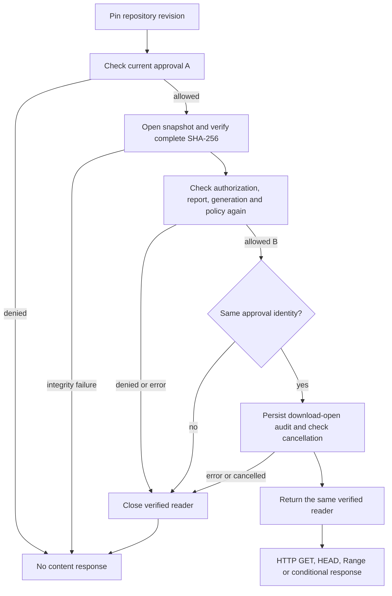

# Revalidate download approval after snapshot verification

## Problem

A complete hash of a large model takes time. Previously `OpenApproved` checked
authorization, the current scanner generation, report and policy, then asked
the artifact adapter to open and hash the snapshot. A policy update, forced
rescan, permission revocation or scanner-generation change during that hash
could leave the service returning a reader under the earlier approval.

The bytes could be correct while the approval had become stale. This is a
control-plane race, distinct from replacing the file after it was scanned.

## Implementation

The domain service now checks admission again after the adapter verifies the
snapshot, before returning its reader to the transport:



The compared identity is:

```text
report ID, task ID, scanner generation, policy version,
artifact ID, SHA-256, byte count
```

A changed identity returns `ApprovalChanged`; a currently blocked or incomplete
revision retains the existing precise admission error. Every new failure path
closes the already-open reader. Audit persistence failures also deny delivery.

The second check does **not** open another file, calculate another artifact
hash, or replace the descriptor. Snapshot hashing still covers all bytes once
per download open. Small control-plane reads and a second admission audit are
the additional work; their deployed latency has not yet been measured.

## Verification

The deterministic regression changes state inside the mock artifact adapter's
`Open` callback, representing a change during the complete hash without timing
dependent sleeps. It checks policy versions and thresholds, pending rescans,
unavailable/current new scanner generations, replacement reports/tasks,
artifact identity, digest, size, permission revocation and cancellation.

It also covers failure of the second admission audit, the revalidation-denial
audit and the final open audit, plus cancellation during audit. A stable
approval returns the exact original reader. Mock expectations permit only one
artifact `Open` call.

The original service failed the first reproducer run; that evidence is retained
in `runtime/optimization-v13-20261022/domain-admission-before/`. The final
Windows Go 1.26.8/CGO-disabled domain suite passed with no skips and unchanged
source in `domain-admission-after-v2/`. Its 125 pass events include parent tests
and subtests and must not be presented as 125 independent test methods.

This is an offline domain regression, not a live deployment or concurrency-race
detector result. The Linux race suite and fresh application acceptance remain
separate required checks.

## Boundary

This closes the long snapshot-verification window. It does not promise instant
revocation after the final check or after response transmission starts. There
is no transaction spanning scanner health, authorization, policy and an entire
HTTP stream. It also does not defend against a compromised trusted writer or
administrator rewriting an open file. The single trusted writer and read-only
scanner staging boundary remain required.

Range, HEAD and conditional requests continue to pay the complete snapshot
verification cost. A small range or a 304 response is not a shortcut around
artifact integrity checks.
