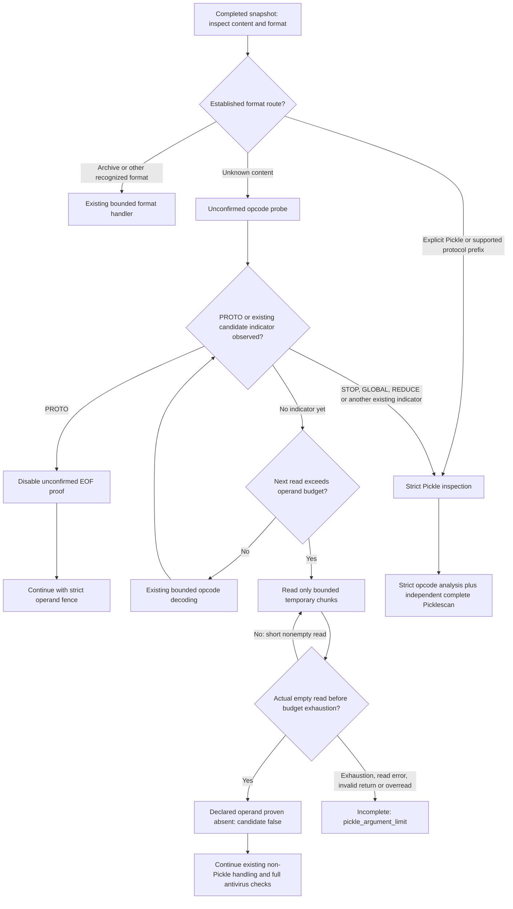

# v13 candidate: bounded EOF proof during unconfirmed Pickle probing

This is a compatibility repair prompted by a real native acceptance failure. It distinguishes an unconfirmed format hypothesis from a confirmed Pickle stream while preserving the existing operand allocation fence. It does not change ClamAV signatures or grant download permission by itself.

## The observed failure

The first actual native run used scanner `d823484c4788a9d6baa24245021ae80043d7d18bf8bdef553c34e6e32a80bfbc`. The candidate passed 24 of 27 cases. Three harmless antivirus positive controls failed: the standard EICAR control as an opaque `.com` file, inside a ZIP, and inside a nested ZIP. Each returned HTTP 422 with `pickle_argument_limit`, rather than a complete result containing the required critical ClamAV finding. These are failures, not successful antivirus detections. The harness expectations were not weakened or edited.

The direct v12.2 baseline is recorded as `OBSERVED` for all 27 cases, with 17 judgments matching the candidate expectations. That observation is not a baseline acceptance PASS.

The format problem was a first-byte coincidence. ASCII `X` is also Pickle's length-bearing `BINUNICODE` opcode. In an unknown short text file, the next four ordinary text bytes could therefore be interpreted as an enormous declared operand length. The allocation fence correctly refused to forward that huge read. However, at this point the generic probe had not established that the input was Pickle. Promoting the probe's budget error to a whole-request error suppressed successful report completion, including the expected antivirus evidence.

The original failure is retained in [native-first-failure-summary.json](../../evidence/v13/candidate-probe/native-first-failure-summary.json), which binds both original raw receipt hashes. No antivirus finding is inferred from the source code or from the names of these controls.

## Routing and implementation

The implementation is in [scanner.py](../../source/deploy/security-scanner/scanner.py), specifically `PickleOpcodeReader.read`, `StaticInspector.pickle_candidate`, and the unchanged strict `inspect_pickle` path.

Recognized ZIP/TAR and other format routes continue to run first. Explicit Pickle extensions and supported Pickle protocol prefixes retain strict inspection. For content without an established Pickle context, `pickle_candidate` disassembles opcodes without loading the object. Only that candidate probe constructs `PickleOpcodeReader(..., unconfirmed_probe=True)`. The default remains strict.



The bounded proof runs only when a requested read exceeds `max_pickle_argument` and the stream is still unconfirmed. It does not issue `read(declared_length)`. It requests at most 64 KiB at a time, decreases the original argument budget by bytes actually delivered, and never concatenates those chunks into the declared operand. An actual empty byte string is required to establish EOF. A short nonempty read is not EOF and consumes the budget before the loop continues.

If EOF is established in this narrow case, the reader raises an ordinary format `ValueError`. The candidate parser's existing syntax-error handling returns `False`, meaning only that this attempt has not established a Pickle serialization context. It is not a safety verdict, an antivirus exemption, or an approval to download.

A `PROTO` opcode immediately disables this proof for subsequent reads. Unsupported protocol versions keep their existing rejection. The existing executable/reference indicators and `STOP` return candidate `True` immediately, selecting complete strict inspection. Both full `inspect_pickle` and its independent Picklescan pass use the default strict reader, including the sticky budget-exceeded check. There is no special-case approval for EICAR content, a standard string, `.com`, a benign-looking filename, or an archive member name.

## Why the bounded proof is sufficient

Let `n` be the declared operand length, `m` the existing per-argument byte budget, and `t` the bytes consumed by this proof after reading the operand header. The new branch is entered only when:

```math
n > m.
```

Each requested chunk has size

```math
a_i = \min(m-t_i,\;65{,}536),\qquad
0 \leq |r_i| \leq a_i,\qquad
t_{i+1}=t_i+|r_i|.
```

Thus the loop maintains

```math
0 \leq t_i \leq m < n.
```

For this completed, seekable input, a true empty read while there is still budget proves that only `t < m < n` bytes of the supposed operand exist. The declared operand cannot be present, so this is a truncated format hypothesis. No oversized operand allocation is needed to establish that fact.

At the exact boundary `t = m`, the loop rejects without requesting one extra byte to discover EOF. Even if the file ends exactly there, absence has not been proved within the permitted reads. Unknown large text whose EOF cannot be established within `m` remains conservatively incomplete. A read exception, a non-`bytes` result, or a reader returning more than requested also retains `pickle_argument_limit`.

The extra temporary chunks for this proof use `O(64 KiB)` storage and consume at most `m` operand bytes. This statement is specific to the oversized, unconfirmed EOF-proof branch. It is not a claim that the whole Pickle parser or scanner has 64 KiB total memory, or that all cumulative allocations fit within the default 8 MiB operand limit. Other parsing, archive, AV, and subprocess resources retain their existing budgets.

## Preserved security checks

| Check | Behavior after the repair |
| --- | --- |
| Full ClamAV analysis | Unchanged for whole artifacts; unknown content is not exempted. |
| Complete artifact SHA-256 and held-file integrity checks | Unchanged before and after scanning. |
| Confirmed Pickle and explicit Pickle routes | Strict operand limits remain in force. |
| Full independent Picklescan pass | Still required on Pickle inspection; sticky limit state cannot become a clean empty result. |
| Observed code/reference indicators | Still select strict inspection immediately. |
| I/O anomalies, exhausted budget and unsupported coverage | Remain incomplete/rejected under existing error semantics. |
| `FILE_ERROR_CODES`, prefix admission, rule generation, policy and download admission | Unchanged by this patch. |

This repair does not implement the separately deferred FRAME work, execute a model, deserialize an untrusted object, or introduce a framework allowlist.

## Actual focused evidence

The focused tests use the real `StaticInspector` and Picklescan 1.0.5 on Windows, with an import-only OS shim. They use finite inert inputs, bounded read traces, a 30 CPU-second / 256 MiB Windows Job, and no native AV, network, model loading, or application deployment. The fixtures total 141,898 unique input bytes; this is not GB-scale testing or an antivirus accuracy dataset.

| Run | Methods run | Failure events | Error events | Skips | Actual result |
| --- | ---: | ---: | ---: | ---: | --- |
| Original d823 scanner, new regression methods | 13 | 0 | 8 | 0 | FAIL; ordinary short text/ZIP/TAR false rejection reproduced |
| New b95 scanner, original old-test expectations | 14 | 2 | 0 | 0 | FAIL; two old no-PROTO candidate expectations conflicted with proven truncation |
| Final b95 scanner, narrowly updated old method | 14 | 0 | 0 | 0 | PASS |
| Independent final run | 14 | 0 | 0 | 0 | PASS |

The two intermediate failures were not deleted. Exactly one existing regression method was updated: the two no-PROTO `T`/`U` candidate assertions now expect `False` when EOF proves truncation. The same bytes presented as explicit `.pkl` still assert budget rejection. Full `inspect_pickle` expectations and all PROTO cases remain strict. [scope-check.json](../../evidence/v13/candidate-probe/scope-check.json) records this narrow old-test scope.

The 13 new methods cover ordinary ASCII through unknown extensions and ZIP/TAR; proven truncation without PROTO; strict PROTO and explicit-extension behavior; direct full inspection; a real oversized operand and a hidden reference tail; the exact argument boundary; nonempty short reads; budget exhaustion; I/O/invalid-reader behavior; and an already observed reference selecting strict inspection. The independent review verifies that only the reader's probe support and `pickle_candidate` differ in the production AST, with no blocking finding. See [independent-review.json](../../evidence/v13/candidate-probe/independent-review.json) and the exact [reviewed scanner diff](../../evidence/v13/candidate-probe/scanner-reviewed.diff).

## Actual Linux result and remaining acceptance

The new scanner's isolated Linux unit run completed successfully: **180 methods, zero failures, zero errors, zero skips**, 28.645 seconds reported by the launcher. The whole-container cgroup peak was **1,048,588,288 bytes**. Source, baseline, rule database, and launcher identities were unchanged, and the owned container was removed. This is a whole-unit-job peak, not the allocation cost of this probe or GB application capacity. The [Linux summary](../../evidence/v13/candidate-probe/linux-unit-summary.json) binds the original receipt and log hashes without copying their complete command/environment material.

**The second native acceptance run is now terminal PASS: all 27 unchanged candidate expectations matched.** The independent verification checked the original outer receipt and native JSON, every case ID/expectation and actual response semantics, source/rule/launcher identities before and after, and the log SHA. There were 22 HTTP 200 responses and five expected HTTP 422 budget rejections. All three EICAR controls now returned HTTP 200, `complete=true`, and a critical `clamav.Eicar-Test-Signature` finding from ClamAV 1.4.6. No native coverage short-circuit or operational failure was recorded. The direct baseline remains `OBSERVED`: 17 of 27 judgments matched, with none relabelled as a baseline PASS.

The complete native job took 265.878711 seconds and recorded a whole-container peak of 1,149,231,104 bytes. That job includes both variants and startup; it is not a per-candidate peak or GB capacity measurement. See [native-second-pass-summary.json](../../evidence/v13/candidate-probe/native-second-pass-summary.json). Its original native JSON SHA is `548ee743adb408467ca6a16c7418f5856ffaf5662fae3a435bb539c2b7fb2be9`; the outer receipt SHA is `8130fc6cfdd52b079df6c16cfe8767e2e7e9362d45efd516d9e62ca117b041be`.

The original native FAIL remains unchanged. These finite inert/control cases are regression evidence, not an antivirus accuracy rate or a production false-positive estimate. Complete Prepared6 Linux compilation was still RUNNING at this documentation checkpoint. Application/SDK acceptance, full official E2E, KIND and GB performance remain separate claims requiring their own bound-source terminal receipts.

## Source identity and evidence boundary

| Component | SHA-256 |
| --- | --- |
| Scanner | `b95ba560d32523c8e04d01dc2f2b863abfb6e65244d217fa6647e6cb54e4644d` |
| New candidate-probe tests | `e373c9d071455d2011cc504f4c32c3f4654754aa46fcecf506a3a2c6953471ae` |
| Operand-budget tests | `bbc7cae48bbb50460196a96f365be8b7c4659368ef28c6b6a1154a9b29014c33` |
| Prepared6 source manifest, 1542 files / 16 changes | `5b967d7af234ecac747c0b073dbaea71faa3d509e53fd9c4da0a4ce3b86d4db9` |
| Prepared6 overlay | `4be6b872ca266946f96cad3042b62c8c3095458e96c756b1891fd29cc187471c` |

The [explicit evidence manifest](../../evidence/v13/candidate-probe/manifest.json) lists 11 exact original small files and four generated identity/result summaries. Each original copy is compared byte-for-byte and by SHA-256; derived summaries retain their raw source hashes and identify themselves as projections. Models, virus databases, accounts, tokens, full command/environment dumps, old credential helpers, and the runtime directory as a whole are excluded. No new product test was executed while preparing this document or evidence copy.
