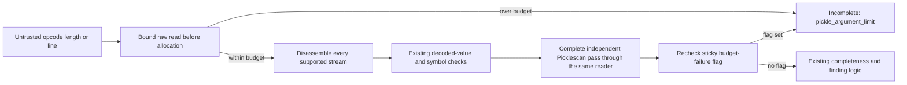

# Reject oversized Pickle operands before allocation

The generic inspector previously checked argument length after
`pickletools.genops` yielded an opcode. CPython reads and decodes an opcode's
argument before yielding it. A tiny file could therefore request a very large
`read(n)` first. Protocol-0 line arguments used an unbounded `readline()`.
`LONG4` is particularly relevant: its decoded argument is an integer, so a
later bytes/string length check does not cover it.

An intercepted baseline probe used at most 22 actual input bytes. It observed
requests for a 1 GiB read or an unbounded line read, then stopped them before
allocation. This proves an unbounded request, not an observed 1 GiB resident
allocation, code execution or successful deployed download.

`PickleOpcodeReader` now wraps both generic entry points and the mandatory final
Picklescan pass. For the configured argument budget A, currently at most 8 MiB:

```text
binary operand: 0 <= requested read length <= A, before delegation
text operand:   underlying readline(A + 1); reject a returned line longer than A
decoded value: retain the existing post-decode argument-length check
```

The extra byte is a bounded sentinel for overlong lines. Protocol-0 newline and
escape syntax count toward the raw budget. UTF-8 byte length can exceed decoded
character length; some previously tolerated large text operands are therefore
outside the new supported profile. This is incomplete coverage, not a malware
classification. Opcode, symbolic-reference and worker resource budgets remain.
The per-read ceiling is not a bound on total parser memory.



Picklescan 1.0.5 catches parsing exceptions and can produce an empty result when
no globals were found. The wrapper records a sticky budget violation. A `finally`
check after Picklescan re-raises it, so the dependency cannot turn a budget
failure into a clean outcome. No deserializer, model loader or referenced
callable is invoked. Full artifact hashes and ClamAV are unchanged.

Seventeen new test methods cover eleven binary length opcodes, eight protocol-0
line families, real-file and boundary cases, protocols 0–5 with actual
Picklescan, concatenated streams and swallowed-error behavior. The integrated
final host parser suite passed 127 methods, zero skips, on Windows with an
import-only OS shim. Linux worker and native AV acceptance remain separate.

There is a measured cost. Seven alternating warm in-memory pairs against the
pre-fence v13 scanner observed:

| Static-only input | Before | After | Observed change |
| --- | ---: | ---: | ---: |
| 256 KiB byte operand | 33.752 us | 35.384 us | +4.84% |
| 10,000 integers | 14.299 ms | 16.594 ms | +16.05% |
| Small protocol-0 metadata | 62.228 us | 66.771 us | +7.30% |

The Python check on each read is a deliberate allocation-defense cost. These
figures do not measure full AV scanning, file I/O or application latency, and do
not support a claim of overall acceleration. Earlier repeated-reference speed
experiments have different source identities and remain historical evidence.

Source and tests:
[scanner.py](../../source/deploy/security-scanner/scanner.py),
[operand_budget_tests.py](../../source/deploy/security-scanner/operand_budget_tests.py).
Retained before/after probes, failures, raw paired timings and identities are
under `runtime/optimization-v13-20261022/operand-budget/` in the development
workspace. The final scanner SHA-256 is
`82f4177ac1f5169168a9a0497b12fed9ad33c46b3bf70b4e4bb62db88877dea6`.
