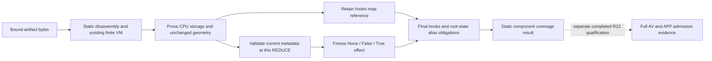

# Restricted static effect semantics for Torch negative metadata

Authors: 林天意, 邹佳颖. Status: **qualified for isolated local integration; original200 regression, independent six full-AV checks and real APP/KIND acceptance completed; not published online**.

This change distinguishes a known constructor's consumed metadata effect from a retained hooks reference inside an existing bounded abstract interpreter. It addresses a narrow compatibility refusal for a proved CPU floating-storage tensor with the exact plain metadata map `{'neg': True}`. It does not run the constructor, import Torch, reconstruct tensors, execute a pickle, or authorize a whole model.

## Bound source identities

| Item | Identity |
|---|---|
| Frozen baseline | `3619a7f3e1f966cefa0a96dfa7d1e3c08895bbb690cf7bfd51bdf1a96bd5f2fe` |
| Candidate v3 | `5fa1c563389f6b70ce16d9a7c3e60fc7c5a452ede2871a231b7e386147500c57` |
| Candidate generation | `33f0af2e302feb2c46d04f210e4c75c19ad267b0620af330b5c653a1febe294b` |
| Candidate scanner image | `sha256:00b6b8ec838ba537dbace416acebcce56f673a07a70136cdf2f1f3f052978b3b` |
| Changed method ASTs | `LegacyMachine.reduce`, `LegacyMachine.final_tokens` only |
| Exact patch | [scanner-3619-to-5fa.patch.txt](scanner-3619-to-5fa.patch.txt), SHA256 `99fc0b6ff7e4917b913e2cb6defde356a09337867292a29bc7d36a4a5bd94045` |

The original `LegacyTensor` six-slot representation, storage/PID rules, geometry checks, root-state checks, ZIP/storage closure, parser budgets, AV path and production exception normalization remain unchanged. The existing restricted constructor interpreter is the baseline mechanism; it is not claimed as a new contribution here. This document makes no academic-priority or general unknown-attack claim. Exact evidence paths and complete hashes are in [evidence-index.json](evidence-index.json).

## Semantic distinction

Let `M` be the current abstract metadata map, `S` the already proved CPU storage, and `H` the hooks map. Each tensor reduction computes a fixed effect `E(M,S)`:

```text
E(M,S) = ABSENT   if M is None
         EMPTY   if M is a LegacyMap, has no items and no state
         NEG     if M is a plain unordered LegacyMap,
                    state is None, keys are exactly {'neg'},
                    M['neg'] is the boolean singleton True,
                    and S has a supported floating storage kind
         REJECT  otherwise
```

Supported floating storage kinds are the existing `HalfStorage`, `BFloat16Storage`, `FloatStorage`, and `DoubleStorage`. The pre-existing persistent-ID proof already requires CPU location. An ordered empty map retains its old accepted behavior; a nonempty ordered metadata map is refused. `{'neg': False}`, `{'neg': 1}`, string values, conjugation or extra keys, stateful metadata, unknown callables, non-CPU storage and negative metadata on nonfloating storage remain outside this profile.

The abstract `NEG` tag records the known negative-view metadata effect; it does not calculate numeric values. Conceptually the represented view is `y = -x`; no `x` or `y` tensor is materialized by the scanner. `ABSENT`, `EMPTY`, and `NEG` are represented by the shared immutable singletons `None`, `False`, and `True` in the existing metadata slot. The internal `False` effect means **consumed empty metadata**; it does not make input `{'neg': False}` valid.



The key invariant is per-use validation. A later mutation of a local metadata map does not rewrite a previously consumed effect. A second reducer that receives the same map validates its **current** contents again. Hooks remain live references: late hook items or state still invalidate the result. If one map serves both roles, snapshotting its metadata effect does not exempt its retained-hooks obligation. Existing final root `_metadata`/version rules still apply to every represented state map.

The file-level positive alias case uses a valid root version-metadata closure after empty metadata is consumed. The token-only `post-neg` local-map scenario is not promoted into a file-format gain: its tested byte closure remains refused. This matters because a token graph alone need not have a legal serialization path through the closed profile.

## Pseudocode and unchanged bounds

```text
reduce_rebuild_tensor(args):
    prove original storage, offset, shape, stride and grad constraints
    H := require empty ordered hooks map with no state
    e := E(current_metadata_argument, storage)
    if e is REJECT: refuse
    prove original address/overflow constraints
    T := LegacyTensor(storage, offset, shape, stride, H, e)
    charge(nodes=1, edges=6)
    return T

final_tokens(root):
    for each T:
        require T.hooks is still empty and has no state
        require T.effect is None or has exact type bool
    run the unchanged root-state and version-metadata closure checks
```

For a nonempty tensor, the existing nonnegative-stride proof retains

`offset + sum_i((shape_i - 1) * stride_i) < storage_numel`,

with the original rank, integer, overflow and file-size bounds. Zero-element tensors retain the original no-element-addressed rule; this change does not tighten or relax it.

The original budget remains

`nodes + edges + |stack| + |memo| <= min(65536, max_pickle_opcodes)`.

There is no new effect node, extra tensor slot or reduced accounting charge. Input maps and their writes remain tracked and budgeted. Both baseline and v3 preserve the original `nodes=1, edges=6` tensor charge and all six `LegacyTensor` slots. Independent repeated-tensor tests at default capacity accepted **9361** tensors and refused ordinal **9362** with `pickle_symbol_budget` for both implementations, in both fixed None/empty-metadata families. This is a bounded test result, not a universal capacity theorem or CPU/RSS performance measurement. [BUDGET], [HOLDOUT33]

## Evidence layers and actual results

| Layer | Actual evidence | What it establishes |
|---|---|---|
| Development tokens | 32 tests PASS | Private VM graph semantics; no file parser, AV or model load |
| Independent token holdout | 33 tests PASS; 260 old-budget comparisons plus default-capacity boundaries | New family cases and unchanged old accounting on the tested graphs |
| Linux real-format static entry | 76 fixtures, 75 matched; overall **FAIL** | Real `StaticInspector.inspect`; real legacy verifier/callback; six observed narrow compatibility gains; no AV |
| CRC finite-class diagnostic | 2 exact-SHA fixtures; `DIAGNOSTIC_CAPTURED`, qualifiedAcceptance=false | Actual exception class at the low-level entry; not acceptance |
| R22 original 200 with full AV | **REGRESSION_PASS** | Same200 bytes;100 normal allow and100 prior-valid deny preserved;0 new oracle/protocol/proof regressions; original oracle192/200 and its eight differences remain |
| R22 independent six-format full AV | **PASS** | Six fixed candidate files2681B completed clean with fullAV,identity,recovery and cleanup; baseline fullAV was not rerun |
| R22 candidate real APP/KIND | **Actual PASS** | Three original risk scenes, five clean files per revision, 30 complete GET/SHA checks and 9 stable403 checks, runtime/resource/cleanup evidence |

The six actual static-entry gains were legacy P2/P4 and Parameter-containing P2 ZIP, each with exact `neg=True` and with the valid consumed-empty/root-version alias case. Baseline refused these six with `unsupported_container_or_serialization`; candidate completed them with zero high/critical findings. The four legacy gains also had complete independent legacy byte-coverage proofs. These are controlled compatibility results on generated inert files, not population false-positive rates and not proof of Torch loadability. [FORMAT76]

The same run's CRC case remained an unexpected low-level operation in both versions. Its original **FAIL75/76 is immutable**. The diagnostic reproduced the exact original clean ZIP and corrupt-storage SHA values and observed `BadZipFile` in both implementations, with `productionKnownFormatException=true`. It deliberately retained `operationError=true` and did not convert the result to PASS. [CRC_DIAGNOSTIC]

Source trace explains the boundary: `read_member` calls ZIP member `read` before its later explicit CRC comparison. `StaticInspector.inspect_zip` catches `LayoutError`; a standard-library `BadZipFile` can escape this low-level component. The pre-existing production worker catches `FORMAT_EXCEPTIONS`, which already includes `BadZipFile`, and maps it to `invalid_serialization` coverage. That normalization is unchanged between3619 and5fa. The diagnostic ran neither the actual production worker nor AV/HTTP, so it does **not** establish a new observed HTTP422 outcome. No generic exception is reclassified as a valid refusal by this algorithm or diagnostic.

## Qualification and attribution boundaries

The original formal source3619/image438, frozen Go worktree and online repositories remain unchanged. Candidate5fa/GEN33f/image00b6 has completed the original200 no-regression comparison, the independent six full-AV checks and the real APP/KIND run, qualifying it for an isolated local branch only. APP v3 completed in661.026354 seconds with30 full GET/SHA checks and9 stable403 checks. The preceding v2 image-wrapper failure101.110082 seconds is retained separately and never reached business assertions. See [ACCEPTANCE_STATUS.json](ACCEPTANCE_STATUS.json) for actual receipt hashes. Resource, namespace/container/network ownership, original-nine preservation and exact cleanup are part of qualification, not optional appendices. Packaging and preparation do not establish product acceptance.

The R22 APP plan preserves the original risk scenes, old-version checks, uncached rescan, scope/cache separation, SDK metadata, full GET hashes, PAT revocation and logout. The appended NEG01 is the already observed348-byte legacyP2 neg fixture, SHA256 `47526a78e7627c20566ff74d9ba68e8c4bdea5d664ced0bf2866b55bb597dafe`; it is generated only after clientPod Linux/private-noexec-RAM guards. Preparation created no serialized bytes or credentials. Existing GoHEAD6741/ELF137bee/appimage967 retain their prior compatibility evidence; this is not a claim that a new candidate head ran the official187 suite.

R21's measured27-cell batch study belongs to source3619. Its batch/native configuration effects are not a measured speedup caused by this semantic change. No candidate-throughput improvement has been measured here. The R21 public28 results also remain source3619 results, with overallFAIL and unresolved oracle boundaries; they do not migrate to candidate5fa. GPU work was cancelled, and no unknown-backdoor, training or arbitrary-weight-poisoning conclusion follows.

Evidence identifiers in this document resolve to exact files and full SHA256 values in [evidence-index.json](evidence-index.json). New terminal results must be added as new evidence, never by rewriting the original failed probe or altering its oracle.


## Explicit performance attribution: fixed thread cap, changing concurrency

| Batch files per request | native_threads cap | Actual native concurrency in these cells | Serial HTTP requests for four files |
|---|---:|---:|---:|
| 1 | 4 | min(4,1)=1 | 4 |
| 2 | 4 | min(4,2)=2 | 2 |
| 4 | 4 | min(4,4)=4 | 1 |

The cited source3619 four-file comparison has request-sequence medians53.91s and15.11s. Their ratio53.91/15.11≈3.568 is a configuration benefit from native concurrency1→4 plus possible fixed-overhead amortization across fewer requests. It is neither a single-lane algorithm speedup nor a fixed-concurrency comparison. The HTTP API still has one active request; native file concurrency within that request changes. Candidate5fa improves static compatibility and alias/effect correctness; no fixed-concurrency algorithm speed improvement has been measured for it.

## APP wrapper repair history

APPv2 actually failed after101.110082s at phase images, receiptff3d08e08a0733779acb81cf1bdd27ecdd2f89fe59bd27e501ac5a70f4fe158f. Business assertions were not reached: this is a harness integration failure, neither a security-detection failure nor a business PASS. kind_cli still pinned the old scanner at two precise mappings (PINNED_IMAGES and scanner archive proof role). APPv3 changes those exact tag/id mappings, keeps the four-image whitelist exact and refuses the old tag or a new tag resolving to the old ID. The corrected package and16 entry tests are preparation evidence; only the new actual APP terminal may establish business acceptance.
