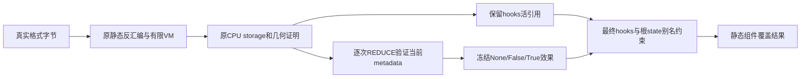

# 受限静态效果语义：负视图 metadata 候选

作者：林天意、邹佳颖。当前状态：**已具备本地集成资格；原200为REGRESSION_PASS、独立6项全AV和真实APP/KIND均已实际PASS；未线上发布**。

## 本次具体改变

基线源码 SHA 为 `3619a7f3e1f966cefa0a96dfa7d1e3c08895bbb690cf7bfd51bdf1a96bd5f2fe`，候选为 `5fa1c563389f6b70ce16d9a7c3e60fc7c5a452ede2871a231b7e386147500c57`。全文件 AST 对照仅改变 `LegacyMachine.reduce`、`LegacyMachine.final_tokens` 两方法。源码差异（见所附证据包 scanner-3619-to-5fa.patch.txt） 的 SHA 为 `99fc0b6ff7e4917b913e2cb6defde356a09337867292a29bc7d36a4a5bd94045`。

已有的受限构造器解释器、静态反汇编、CPU storage 与几何证明都是原机制，本次不能把它们重新包装为“新增算法”。具体增量是在已知 CPU 浮点 storage 的 `_rebuild_tensor_v2` 参数中，证明精确普通字典 `{'neg': True}` 的已消费效果，同时区分仍被保留的 hooks 引用。不宣称学术首创，也不泛化为未知攻击检测。

## 抽象语义及别名义务

每次 REDUCE 都检查当前 metadata：

| 输入 | 保存到原 metadata 槽的内部效果 |
|---|---|
| None | None，表示未提供 |
| 无 items、无 state 的 LegacyMap | False，表示消费了空 metadata；原 ordered 空图仍兼容 |
| 无 state、非 ordered、键严格为 neg、值必须是布尔单例 True，且 storage 为已知 CPU 浮点类型 | True，表示已证明的负视图标记 |
| 其他输入 | 拒绝 |

支持的浮点 storage 沿用 Half/BFloat16/Float/Double。输入 `{'neg': False}`、整数1、字符串、额外键、conj、带 state 的图、非CPU或非浮点负 metadata 仍拒绝。内部 False 不是接受输入 neg=False；它只表示已消费的空图。概念上负视图为 y=-x，扫描器只记录已知效果，既不计算数值，也不物化张量。



伪代码：

```text
证明原storage、offset、shape、stride、grad约束
要求hooks为当前空ordered图且无state
effect := consume_metadata(当前map, 已证明storage)
不支持的effect立即拒绝
执行原几何/溢出约束
沿用LegacyTensor原6槽保存hooks引用和effect单例
保持每tensor计费nodes=1、edges=6
最终逐tensor重查hooks仍为空且无state
effect只能为None或精确bool；原根_metadata/version闭合检查继续执行
```

本地 metadata 消费后的修改不能倒改已保存的效果；同一 map 再被另一个 reducer 使用时必须重新检查当前值。hooks 则保持活引用，后续加项或 state 仍拒绝。同一对象兼作 metadata 与 hooks，也不能借效果快照免除 hooks 义务。所有输入 map 及写操作仍被追踪和计费。

字节格式层的正向后别名案例用合法根版本 metadata 闭合来表达“空 metadata 已消费后再用于版本信息”。纯 token 的 post-neg 本地追加模式，不因此被宣称为合法字节格式收益；它的被测闭合仍按原约束拒绝。

## 预算与几何边界不回退

原槽预算保持 `nodes + edges + |stack| + |memo| <= min(65536, max_pickle_opcodes)`。原6个 LegacyTensor 槽和 `nodes1/edges6` 计费不变；没有增加效果节点、减少计费或绕开 map 写入预算。对固定 None/empty 两族默认容量压力图，基线和候选均接受9361个 tensor，在第9362次尝试因 `pickle_symbol_budget` 拒绝。独立审还比较了260个旧预算结果。该结论只针对这些图，不等于任意图容量定理，也没有CPU/RSS提速测量。

非空 tensor 的原地址上界仍是 `offset + sum((shape_i-1)*stride_i) < storage_numel`，秩、类型、溢出、文件尺寸约束均不变；零元素 tensor 保留原本“不寻址元素”的规则。

## 已有证据与验收层次

| 层次 | 实际状态 | 不得越界的解释 |
|---|---|---|
| 开发VM tokens | 32项通过 | 仅抽象图；没有文件入口、AV或模型加载 |
| 独立holdout | 33项通过，260个旧预算比较和9361/9362边界通过 | 独立token语义与被测预算；不是总体准确率 |
| Linux真实静态格式入口 | 76项中75符合，整体FAIL；实际6项兼容增益 | 真实StaticInspector/legacy验证；没有全AV与APP |
| CRC两例有限异常类诊断 | DIAGNOSTIC_CAPTURED；qualifiedAcceptance=false | 只解释低层异常类，不能抹去原FAIL |
| R22原200全AV | REGRESSION_PASS | 同200bytes；100正常允许与100既有有效拒绝均保留；新增oracle/protocol/proof退化0；旧oracle192/200的8项差异仍保留 |
| R22独立6格式全AV | PASS | 6个固定候选输入2681B，完整AV/static clean、身份/恢复/清理通过；未重跑baseline fullAV |
| R22候选APP/KIND | 实际PASS | 3个原风险场景，30次完整GET/SHA及9次稳定403；隔离/清理/原9服务核验通过 |

6项真实静态增益是 legacyP2、legacyP4、含Parameter的P2ZIP三族各2项：精确neg=True，以及合法已消费空metadata/根版本别名闭合。基线拒绝，候选完整且无high/critical发现。4项legacy增益还有真实legacy字节分区覆盖证明。它们是受控惰性文件的兼容性观察，不是恶意总体误报率，更不是任意Torch模型可加载保证。

## CRC 原失败如何解释

原76项收据 SHA `a00f6c81855077cdc8a2f2bf9d8aee46b17f98922727f4d3bce63df82065c711` 保持整体FAIL/75of76。唯一CRC样本在两边都是 unexpected-static-operation，不能按“拒绝了就算通过”。

后续诊断收据 SHA `07c641db1967cd68f37285d8c25b9df8f384cd05bc77c8f55d2d1fe9dd55bee6` 复现原clean ZIP及CRC损坏样本的完整SHA，两边实际观察到 BadZipFile，`productionKnownFormatException=true`，同时保留 `operationError=true`、原目标未达和 qualifiedAcceptance=false。诊断未执行AV、真实生产worker或HTTP，所以不能宣称观察到HTTP422。

源码中 read_member 的ZIP读取发生在后续显式CRC比较之前；低层 StaticInspector 只正规化 LayoutError，BadZipFile可以穿透。生产 worker 原本就通过 FORMAT_EXCEPTIONS（已含BadZipFile）映射为 invalid_serialization 覆盖，这段代码基线与候选相同。本次没有新增“所有异常都视作有效拒绝”的规则。

## 交付与归因边界

原正式W、scanner3619/image438及线上仓库保持原样。候选5fa/GEN33f/image00b6已完成原200无回退对照、独立6项完整扫描和真实APP/KIND验收，获准仅在独立本地分支集成。APP v3实际661.026354秒、30次完整GET/SHA和9次稳定403；此前v2镜像wrapper失败101.110082秒独立保留，未执行到业务断言。实际收据见ACCEPTANCE_STATUS.json；准备锁、纯测试及打包成功不算应用验收。

APP新增NEG01为348字节惰性legacyP2neg文件，SHA `47526a78e7627c20566ff74d9ba68e8c4bdea5d664ced0bf2866b55bb597dafe`，仅clientPod Linux私有noexec RAM guard后生成。原3风险、old-version、ForceRescan、租户/缓存、SDK、PAT撤销和logout继续保留。每场初始clean5次及旧clean5次，3场已验证30次完整GET/SHA。GoHEAD6741、ELF137bee、appimage967不变，只保留其原compat187证据，不宣称新candidate head已重跑187。

R21真实27格性能属于旧source3619，批量/native配置收益不能写成此算法提速；R21 public28同样不迁移到候选。GPU取消，不据此声称训练后门、任意权重投毒或未知攻击防御。已有受限构造器不是新创新；交付聚焦此次已消费效果/保留活引用的具体语义改动。

所有引用的真实路径和完整SHA见 [evidence-index.json](evidence-index.json)。新终态应追加新证据，原失败及oracle不重写。


## 性能口径必须展开并发变化

| 每请求batch | native_threads固定上限 | 本组cell实际native并发 | 四文件cell的串行HTTP请求数 |
|---|---:|---:|---:|
| 1 | 4 | min(4,1)=1 | 4 |
| 2 | 4 | min(4,2)=2 | 2 |
| 4 | 4 | min(4,4)=4 | 1 |

原source3619四文件对照引用的请求序列中位数为53.91s和15.11s，53.91/15.11约3.568。它来自native实际并发1→4以及更少请求可能带来的固定开销摊薄，既不是单路算法提速，也不是固定并发条件的算法对照。HTTP同时仍只有一个活动请求，变化的是请求内部的文件native并发。新候选5fa是静态兼容及别名/效果正确性改进，目前没有固定并发算法提速实测。

## APP包装器修复历史

APPv2实际在images阶段失败，whole job101.110082s，收据SHAff3d08e08a0733779acb81cf1bdd27ecdd2f89fe59bd27e501ac5a70f4fe158f。它尚未达到业务断言，属于评测包装集成失败，不能称安全检测失败或业务通过。kind_cli两处映射仍锁旧scanner：PINNED_IMAGES与导出proof的scanner角色键。v3只精确切换这两处tag/id，镜像白名单仍为4项，无通配/额外镜像，旧tag或新tag返回旧ID仍拒绝。修复包与16项entry纯测试仅为准备证据，业务结果必须等待新的实际APP终态。
