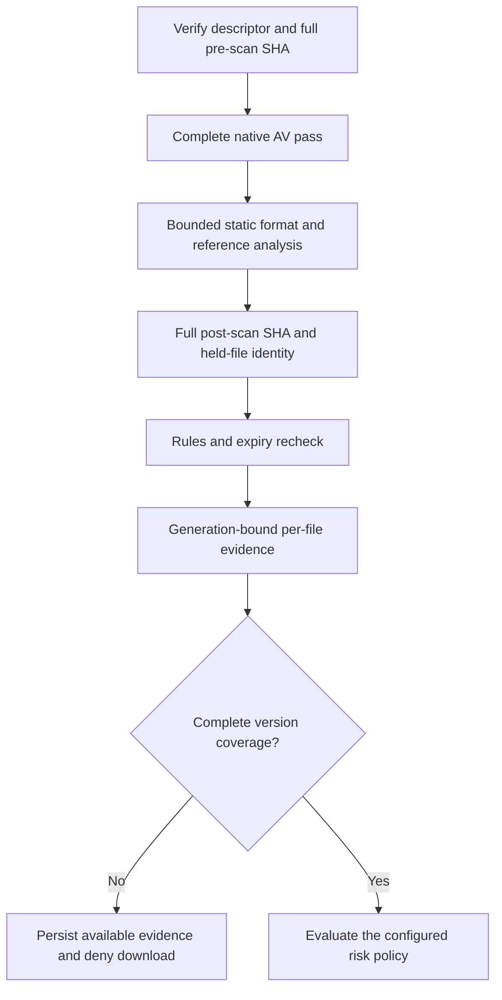

# Preserving risk evidence without weakening incomplete-scan rejection

This change addresses three evidence gaps observed in a frozen 200-artifact
regression. It does not deserialize model artifacts, execute referenced code,
or replace whole-file antivirus scanning with sampling. The historical report,
input bytes and original expected outcomes remain independent of this candidate.

## Layer boundaries

Integrity failures, native-engine failures, timeouts and global resource failures
still invalidate the request. Evidence retention is not permission to download.

## Exact restricted importer references

The local static policy recognizes the exact `builtins.__import__` and legacy
`__builtin__.__import__` symbols, even when the pinned dependency classifies them
as suspicious. It records a restricted capability reference, not proof that an
import occurred. Literal, GLOBAL, STACK_GLOBAL and memo handling remain bounded;
unresolved symbols and mixed unknown references cannot establish full coverage.
The existing finding schema is used by the Go API. Structured opcode locations
remain limited to the previously supported nested-deserializer rule; this
classification does not expose arbitrary operand text or add a new evidence ID.

## Declared Safetensors with conflicting serialization content

Valid Safetensors are validated before any generic Pickle probing. A legitimate
128-byte header shares leading bytes with a Pickle protocol marker and must not
be reported as dangerous merely because of those bytes.

If strict Safetensors validation fails, an explicit Pickle protocol prefix may
trigger a second, evidence-only static probe. The probe has independent ceilings
of 64 KiB and 4096 opcodes, and returns only definite restricted references. It
cannot turn the original format failure into successful format validation. The
original coverage error and `complete=false` are preserved.

## AV evidence followed by a local Pickle operand limit

Previously a `pickle_argument_limit` exception discarded the response containing
an already established AV match. The new protocol retains that match only when
the **same artifact** already has the fixed canonical `clamav` finding:

- rule `malware.signature-match`, severity `critical`;
- the exact fixed match message and remediation;
- no reference evidence or additional finding fields.

Native parsers emit the canonical category and the actual, strictly parsed
signature as separate findings. Limit, encrypted, broken, missing and malformed
native responses cannot generate that canonical match. The two findings describe
one artifact result and must not be counted as two detections.

Only the exact local operand-limit error may be retained through this path. A
match on another batch member cannot authorize retention. The worker must still
finish the whole-file post-SHA, held-file identity, rule inventory and expiry
checks. The result contains exactly one fixed `coverage.pickle_argument_limit`
finding and remains incomplete. The Python report validator and Go
`security.ValidateAnalysisCoverage` enforce the same narrow predicate.

The domain service stores the available AV evidence, marks the revision failed,
and rejects downloads in both enforcement and audit modes. It cannot cache this
as a complete successful result. No general resource-error allowlist is added.

## Explicit binary reading of GZIP members

Real Linux static controls exposed a separate existing mode-inference defect.
The traversal uses writable spooled temporary files for bounded archive members.
Without an explicit mode, `gzip.GzipFile` may inherit `w+b` and enter its writer
path instead of inspecting the compressed input. The fix is `mode="rb"` at the
reader construction. No depth, expansion, CRC, native AV or integrity limit is
removed. Regressions cover named writable files, spooled files before and after
rollover, unchanged input size/hash, and the depth-three/depth-four boundary.
The failed initial supplemental run remains separate from the fixed-source run.

## Regression interpretation

The original 200 byte-identical controls and original scoring logic are rerun.
A second, pre-registered eight-case evidence gate checks the intended changes:
four valid importer references may become fully classified; the conflicting
Safetensors and three operand-limited archive cases must retain their incomplete
status while exposing the target risk evidence. These are different assertions.
The latter three still do not satisfy the old complete-AV-coverage expectation.

Other historical mismatches describe earlier valid refusals or fixtures containing
multiple defects. Targeted static controls distinguish those branches without
loosening native AV alerts or rewriting the original dataset.

A small controlled corpus does not establish general malware accuracy, model
weight/backdoor safety or inference behavior. Application mocks, independent
scanner executions and real deployed application/Kubernetes tests are reported
separately. This source change creates a new scanner generation; previous cached
results cannot establish approval for the new generation.
