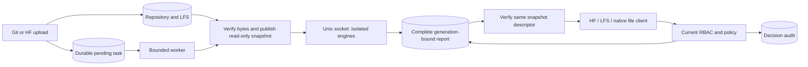

# Artifact evidence and consistent download admission

## Problem and resulting behavior

A model revision can contain arbitrary Git blobs and Git LFS objects. A clean
report is useful only when the content returned to a client is the content that
was completely analyzed. This contribution binds a complete file manifest to
one immutable commit and scanner generation, then serves the verified read-only
snapshot through supported file transports.

Upload succeeds independently of asynchronous analysis. Until the required
engines complete every file, protected downloads are denied. A finding can
block the entire revision according to the current project policy. Scan errors,
coverage limits, absent engines and abandoned tasks never become a clean report.

## Implementation paths considered

1. **Artifact evidence and consistent admission (selected).** Verify actual LFS
   size and SHA256, freeze the commit, stage immutable snapshots, and gate every
   supported content outlet. This produces a directly reviewable MatrixHub
   contribution rather than a stand-alone scanner demo.
2. **Isolated analysis service.** Run mature ClamAV and Picklescan engines in a
   credential-free, network-less container. Its rule generation includes engine
   versions, rule hashes, wrapper code and coverage limits. This is a required
   supporting component of the selected implementation.
3. **Fault recovery and evidence console.** Persist six states, use token and
   attempt fencing, preserve immutable report history, enforce current RBAC and
   policy, and expose auditable rescan/cancel/policy operations and a localized
   UI. These complete the selected implementation.

The architecture and tradeoffs were reviewed by an ASTRA ULTRA sub-agent at the
user's request. No award, security coverage or community acceptance is assumed.

## Boundaries and flow

- Domain interfaces live in `internal/domain/security`; no domain dependency
  points to repository implementations.
- Repository adapters implement durable evidence, immutable staging and the
  Unix-socket scanner protocol.
- HTTP, HF, LFS and SSH handlers call the domain gate. The REST handler exposes
  evidence and administrative operations through the existing authentication.
- The job processor calls the domain service and limits simultaneous work.
- SQLite and MySQL migrations create task, report, analysis-cache, policy and
  audit tables.

## Invariants

**Scope.** Durable keys use stable project and model IDs, not only namespace
names. Deleting and recreating a name cannot inherit old approvals, policies,
audit entries or caches. Permissions are checked at each evidence read, policy
change and content open.

**Content.** A ref is resolved once before reading its tree. LFS pointers must
match the real object's declared length and SHA256. Staging fully reads and
hashes the content before atomic publication. Download opens the approved
snapshot, verifies its digest on that same descriptor and seeks back to the
start; it does not reopen the mutable origin.

**Coverage.** Every file must have a complete analysis from the exact generation
and both required engines. Size, file count, archive and engine limits are
failures of coverage. An incomplete report cannot admit a download even under
audit mode. The risk of all files is reevaluated against current policy.

**Concurrency.** Completion must match the current lease token and attempt, and
the lease must still be valid. A canceled, replaced, timed-out or previous
worker cannot overwrite a later result. Complete reports and reusable analyses
are committed in one transaction. A forced rescan creates a new attempt while
retaining historical evidence.

**Generation and cache.** Cache keys include stable scope, content digest, size,
type and scanner generation. Incomplete analyses are not reused. Rule changes
invalidate the current report; policy changes reevaluate existing findings and
retain their policy version in each decision.

**Isolation.** The scanner has read-only input/rules, no MatrixHub credentials,
no Docker socket, no general TCP endpoint and no network. Container and child
process limits bound memory, CPU, processes, temporary storage and duration.
No supplied model is unpickled, loaded into a framework or imported.

## Supported and restricted entry points

| Entry | Protected behavior |
| --- | --- |
| HF resolve and resolve-cache | Commit is frozen; GET, HEAD and Range use approved snapshot |
| Native model file preview/download | Blob URL carries immutable commit and reaches the same HF gate |
| Repository LFS batch/content | Actions bind repository, commit, OID and size; content rechecks current admission |
| Global LFS object GET/HEAD | Denied when security is enabled; no repository authorization context |
| HTTP/SSH Git fetch | Denied under global enforce mode, because pack history is not file-filtered |
| HF comparison patch / native commit diff | Disabled under global enforce mode to prevent historic blob leakage |
| Upload | Remains available; scan is asynchronous |
| Evidence REST and UI | Existing identity plus project permissions; bounded requests and no-store responses |

Raw Git restrictions are deliberate compatibility costs. A future pack filter
would need to prove that every reachable object satisfies policy, including
history. It is not claimed by this implementation.

## Capacity and operational limits

The initial default limits are 64 MiB per file, 256 MiB per task, 1,000 files,
2 GiB retained staging, one worker and a two-minute task timeout. These are
coverage limits for the first version, not an assertion that multi-GB production
models have been validated.

The isolated scanner admits one parsing child at a time under its 3 GiB
container memory budget. The application default matches that capacity.
Increasing application concurrency requires a matched scanner deployment and
new resource measurements; overload fails closed.

Published snapshots and historical reports are retained. The first version
requires offline report-aware cleanup when staging reaches its quota; it fails
closed instead of deleting files that may still be referenced by reports or
open readers. One MatrixHub process owns a staging root. Multi-replica shared
writers and automatic garbage collection are outside the validated scope.

## Existing related work

The upstream repository already contains related pull request #1067. At the
reviewed head it reads real LFS bytes; claiming it only scans pointer text would
be inaccurate. Our differentiated work focuses on byte verification, immutable
scan/download binding, complete transport admission and concurrency fencing.

Static comparisons are architectural observations, not reproduced vulnerability
claims. The implementation and its own tests must carry the contribution.

## Reproduction and delivery

The final test report will enumerate actual commands, environment, sample
generation, logs, failures, repairs, timings and limitations. Planned checks
are not counted as passed. Public issue/design discussion and maintainer
recognition remain external delivery steps; no post is sent without the user's
explicit authorization.

## Rules storage backends and capacity profiles

Two deployment dimensions are deliberately independent: how large a single file
may be, and where the deployment stores its data and its verified rules.

Profiles (`deploy/security/profiles/*.json`) carry the scan limits, the container
ceilings and a `scannerEnvelope` block that mirrors the fixed ceiling enforced by
`deploy/security-scanner/scanner.py`. The setup wrapper refuses a profile whose
scanner environment exceeds that envelope before any container starts, and a unit
test re-derives the envelope from the scanner source so the numbers cannot drift
silently. `--storage volumes` keeps data on Compose named volumes and therefore
works on Docker Desktop without POSIX host paths; `--storage bind` keeps the
native permission probe and free-space budget for POSIX capacity filesystems.
A larger per-file limit no longer implies a host bind mount.

The scanner accepts exactly one rules source. With `--rules-backend bind` the
verified snapshot is mounted read-only at `/rules`; with `--rules-backend ram` a
generated bootstrap copies it into a private tmpfs inside the scanner container,
re-hashes source and copy, requires `/rules` to actually be tmpfs, and only then
execs the real scanner. The copy runs inside the scanner because a named tmpfs
volume is private to one container and cannot be pre-filled from the host or from
another container. Any mismatch stops the container, so a failed copy can never
be read as a clean scan. The measured cost is about 2.3 seconds for the current
~112 MiB snapshot, which is reported separately from scan time.

The rules mount lives in an explicit Compose overlay
(`compose.rules-bind.yaml` or `compose.rules-ram.yaml`) because a bind mount and a
tmpfs mount cannot share the `/rules` target in one service definition. Running
`compose.yaml` alone leaves the scanner without rules; the scanner refuses to
start rather than scanning with an incomplete rule set.
